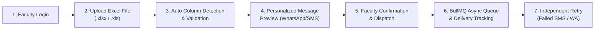

# MarkAlert — Faculty-to-Parent Notification System

**MarkAlert** is a dedicated, production-grade notification platform built specifically for engineering college faculty to automate communicating students' internal examination marks to registered parents via **WhatsApp** and **SMS**.

> **Important Architecture Decision:**
> MarkAlert is **NOT a College Management System (CMS/ERP)**. It does not maintain permanent student/parent rosters or attendance/fee records. The faculty member's existing Excel spreadsheet is the single source of truth per examination batch.

---

## 🌟 Core Workflow



---

## 🚀 Key Features

1. **Intelligent Excel Ingestion & Auto-Mapping**
   - Upload existing marks sheets directly (`.xlsx`, `.xls`).
   - Fuzzy header detection for `Register Number`, `Student Name`, `Parent Mobile`, and dynamic subject headers (`CN`, `DBMS`, `Java`, `Operating Systems`, etc.).
   - Interactive column mapping interface if automatic detection requires confirmation.
   - Worksheet selection for multi-sheet workbooks.

2. **12-Point Rigorous Validation Engine**
   - Missing student names, register numbers, or mobile numbers.
   - Indian 10-digit mobile number normalization (+91, leading 0, repetitive digit check).
   - Duplicate register number detection.
   - Out-of-range marks (> maximum marks) and negative marks check.
   - Missing marks are never automatically converted to zero.
   - Downloadable CSV error reports for instant faculty correction.

3. **Privacy & Data Security**
   - **Parent phone numbers are masked in all frontend views** (`******3210`).
   - Personal numbers are encrypted at rest (AES-256) in temporary batch storage and decrypted strictly inside background workers.
   - API keys and tokens are never exposed to the client browser.

4. **Multi-Channel Dispatch & Independent Delivery Tracking**
   - Token interpolation: `{{parent_name}}`, `{{student_name}}`, `{{register_number}}`, `{{exam_name}}`, `{{marks}}`, `{{total}}`, `{{maximum_marks}}`, `{{percentage}}`, `{{college_name}}`.
   - Dual channels: **Meta WhatsApp Business Cloud API** and **Indian DLT-Compliant SMS Gateway**.
   - **Independent delivery statuses**: A failed SMS does not cause a successful WhatsApp message to be resent.
   - Safe **Mock Mode** for risk-free local testing and demonstrations.

5. **Asynchronous Background Processing (BullMQ & Redis)**
   - High-throughput asynchronous message queue with idempotency keys.
   - Server-Sent Events (SSE) for live real-time progress updates on the dashboard.
   - Single-click and bulk retry for eligible failed notifications.

6. **Role-Based Access Control (RBAC)**
   - **Admin**: Create and manage faculty accounts, toggle active status, reset passwords, view system-wide delivery performance and audit logs.
   - **Faculty**: Upload Excel sheets, review previews, confirm dispatches, and track personal notification batches.

---

## 🛠 Tech Stack

| Layer | Technology |
|:------|:-----------|
| **Frontend Framework** | React 19 + TypeScript + Vite |
| **Routing** | React Router v7 |
| **State & Data Fetching** | TanStack Query v5 |
| **Forms & Validation** | React Hook Form + Zod |
| **Styling & Icons** | TailwindCSS + Lucide React |
| **Backend Framework** | Node.js + Express 4.21 (TypeScript) |
| **Database & ORM** | PostgreSQL + Prisma ORM 6 |
| **Job Queue** | BullMQ + Redis (with in-process async fallback) |
| **Excel Parser** | xlsx (SheetJS) with custom fuzzy matcher |
| **Testing** | Vitest + Supertest |

---

## 📁 Project Directory Structure

```
markalert/
├── backend/
│   ├── prisma/
│   │   ├── schema.prisma       # Clean relational schema (users, batches, notifications, temp recipients)
│   │   └── seed.ts             # Initial admin & faculty seeding
│   ├── src/
│   │   ├── config/             # Typed environment configuration
│   │   ├── database/           # Prisma client singleton
│   │   ├── middleware/         # JWT auth, role guard, batch ownership, Zod validation
│   │   ├── modules/
│   │   │   ├── auth/           # Login, refresh token rotation, logout, me
│   │   │   ├── users/          # Admin faculty CRUD, status toggle, password reset
│   │   │   ├── batches/        # Draft creation, Excel upload, validation, previews
│   │   │   ├── excel/          # Excel parsing, fuzzy column detection, 12 validation rules
│   │   │   ├── notifications/  # Message preview, send batch, progress tracking, retry
│   │   │   ├── templates/      # WhatsApp and SMS template editor
│   │   │   └── reports/        # Dashboard overview metrics and system settings
│   │   ├── providers/
│   │   │   ├── whatsapp/       # Meta WhatsApp Cloud API provider (with mock mode)
│   │   │   └── sms/            # Fast2SMS / DLT-compliant SMS provider (with mock mode)
│   │   ├── queue/              # BullMQ queue + in-process async fallback worker
│   │   ├── utils/              # Phone validator, template renderer, AES-256 crypto
│   │   ├── webhooks/           # WhatsApp & SMS delivery status callbacks
│   │   ├── tests/              # Vitest unit & supertest API integration suites
│   │   └── server.ts           # Express HTTP server with Helmet, CORS, Rate Limit
│   ├── sample_files/           # Test Excel sheets
│   └── package.json
├── docs/
│   ├── architecture.md         # Full system architecture documentation
│   ├── database-design.md      # Relational schema specification & ER diagram
│   └── api-documentation.md    # Complete REST API v1 endpoint documentation
├── src/
│   ├── components/ui/          # Reusable UI primitives (Button, Input, Badge, Card)
│   ├── layouts/                # Responsive DashboardLayout with sidebar & user profile
│   ├── lib/                    # API client (Axios), Auth context, Query client
│   ├── pages/
│   │   ├── LoginPage.tsx       # Secure sign-in with quick credential presets
│   │   ├── DashboardPage.tsx   # Real metrics, quick action CTA, recent batches
│   │   ├── UploadPage.tsx      # Step 1: Excel drag-and-drop & metadata
│   │   ├── ReviewPage.tsx      # Step 2: Column mapping, row validation, error CSV download
│   │   ├── MessagesPage.tsx    # Step 3: Dual message previews, channel selection, confirm modal
│   │   ├── ProgressPage.tsx    # Step 4: Live progress bar, status breakdown, retry actions
│   │   ├── HistoryPage.tsx     # Full notification logs with search and retry
│   │   ├── AdminDashboardPage.tsx # Admin faculty account management & system overview
│   │   └── SettingsPage.tsx    # College name branding & mock mode toggle
│   ├── types/                  # Typed interfaces matching backend models
│   ├── App.tsx                 # React Router v7 routes with protected & admin guards
│   └── main.tsx                # Entry point
├── tailwind.config.js          # Tailwind design system configuration
└── vite.config.ts              # Vite configuration with API proxy
```

---

## ⚡ Quick Start

### 1. Prerequisites
- **Node.js** (v18+)
- **npm** (v9+)

### 2. Start Both Frontend & Backend Concurrently
```bash
npm run dev
```
- **Frontend SPA**: [http://localhost:5173](http://localhost:5173)
- **Backend API**: [http://localhost:5000/api/v1](http://localhost:5000/api/v1)

### 3. Run Automated Tests
```bash
npm test
```
*Current test suite: 21/21 passing (Unit + Integration + API tests).*

---

## 🔐 Default Login Credentials

| Role | Email | Password | Access Scope |
|:-----|:------|:---------|:-------------|
| **Administrator** | `admin@college.edu` | `Admin@123` | Faculty account management, system-wide delivery metrics, settings |
| **Faculty Member** | `faculty@college.edu` | `Faculty@123` | Upload marks Excel, validate data, dispatch WhatsApp/SMS, personal batch history |

---

## 🧪 Testing with Sample Files

Sample Excel sheets are available in `backend/sample_files/`:
- `sample_marks_standard.xlsx`: 10 students, standard headers (ready for instant 1-click import).
- `sample_marks_varied_columns.xlsx`: Uses alternate column headers to test fuzzy auto-detection.
- `sample_marks_with_errors.xlsx`: Contains intentional errors (duplicate roll numbers, invalid phone numbers, negative marks) to test validation reporting and CSV error exports.
