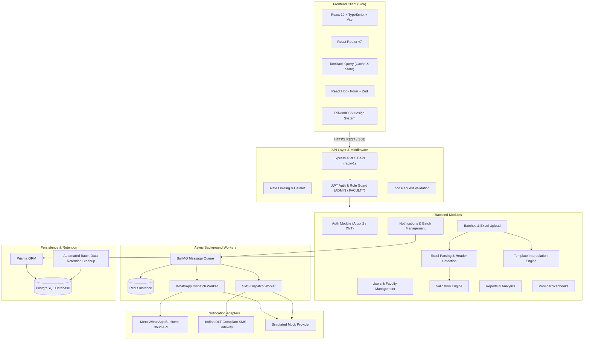

# MarkAlert — System Architecture Documentation

## 1. System Overview
**MarkAlert** is a dedicated Faculty-to-Parent Notification System designed specifically for engineering colleges and universities.

Instead of operating as a full College Management System (CMS/ERP), MarkAlert focuses exclusively on the single critical workflow:
**Empowering faculty to upload existing internal examination Excel mark sheets, automatically validate data and phone numbers, preview personalized marks messages, and dispatch notifications directly to parents via WhatsApp and SMS with end-to-end delivery tracking.**

---

## 2. Architecture Pattern: Modular Monolith
MarkAlert is architected as a **Modular Monolith** with a clear separation of concerns, avoiding microservice operational overhead while enforcing clean module boundaries.

---

## 3. Core Processing Pipeline

1. **Excel Ingestion**: Faculty uploads `.xlsx` or `.xls`.
2. **Worksheet Selection & Auto-Detection**: System parses columns using intelligent regex fuzzy-matching (e.g. `Reg No`, `Register Number`, `Candidate Name`, `Parent Mobile`, subject columns).
3. **Data Extraction & In-Memory Validation**:
   - Checks missing names, missing register numbers, missing or invalid Indian 10-digit mobile numbers.
   - Validates marks (numeric, non-negative, <= max marks).
   - Flags duplicate register numbers.
   - Categorizes rows into `VALID`, `WARNING`, and `ERROR`.
   - Generates CSV error reports for instant faculty download.
4. **Temporary Batch Recipient Storage**:
   - Validated records are stored temporarily in `batch_recipients` with encrypted phone numbers and masked previews.
   - No permanent student/parent directory is created or retained.
5. **Personalized Message Generation**:
   - Template interpolation using tokens (`{{parent_name}}`, `{{student_name}}`, `{{register_number}}`, `{{exam_name}}`, `{{marks}}`, `{{total}}`, `{{percentage}}`, `{{college_name}}`).
   - Generates dual channel previews (WhatsApp format & SMS character-safe format).
6. **Faculty Confirmation**:
   - Faculty reviews, edits individual messages or template if desired, selects channel (`WHATSAPP`, `SMS`, or `BOTH`), and confirms dispatch.
7. **Queued Asynchronous Dispatch**:
   - Individual notifications are created in `notifications` table (`PENDING`).
   - BullMQ queues independent WhatsApp and SMS jobs in Redis.
   - Workers throttle and send messages with idempotency keys.
8. **Independent Delivery Reconciliation**:
   - Provider webhooks receive delivery receipts (`SENT` -> `DELIVERED` or `FAILED`).
   - Statuses for WhatsApp and SMS remain strictly independent.
   - Faculty can retry failed SMS without re-sending delivered WhatsApp messages.
9. **Automated Data Retention**:
   - Once delivery is settled and retention window expires, temporary recipient data and original uploaded files are purged according to data retention policy.

---

## 4. Security Principles
- **No Client Secrets**: WhatsApp Access Tokens, SMS API keys, and database credentials exist exclusively in server environment variables.
- **Privacy Masking**: Parent mobile numbers are masked in all frontend responses (`******3210`). Full numbers are only handled inside backend worker dispatch.
- **Tenant & Role Isolation**:
  - `FACULTY` can only query, preview, send, and retry batches created by themselves.
  - `ADMIN` can manage faculty accounts, configure college settings, and review system-wide audit reports.
- **Stateless Tokens with Rotation**:
  - Access Token: Short-lived (15 minutes).
  - Refresh Token: Long-lived (7 days), stored hashed with revocation support.
