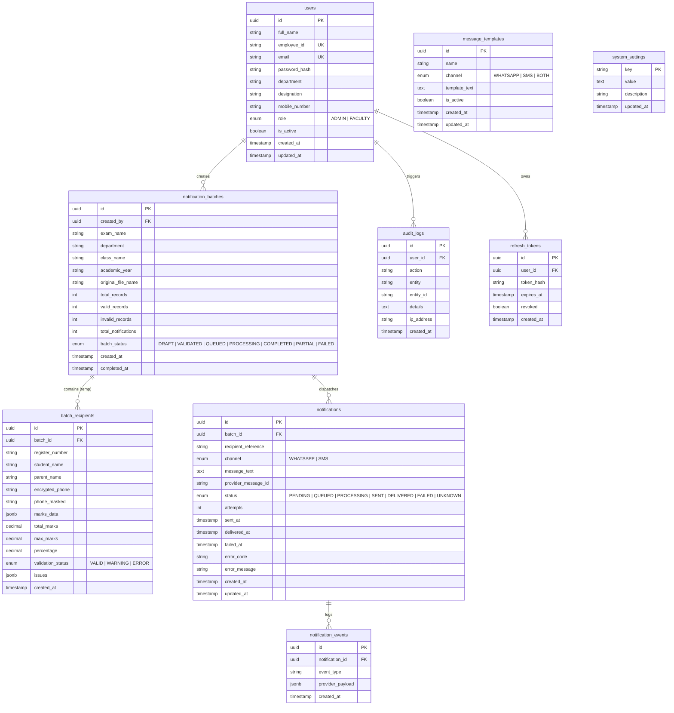

# MarkAlert — Database Design Specification

## 1. Database Philosophy
MarkAlert is **strictly a notification delivery engine**, not a student information system.

### Key Policy Decisions:
- **No permanent student directory**: Student names and register numbers exist only in the context of an uploaded examination batch.
- **No permanent parent directory**: Parent mobile numbers are supplied directly via the Excel file per upload.
- **Temporary Recipient Storage with Retention**: Uploaded student and parent records are stored in `batch_recipients` with encrypted mobile numbers strictly for the lifecycle of the notification batch and audit retention, then purged.

---

## 2. Entity Relationship Diagram

---

## 3. Detailed Table Definitions

### `users`
Represents administrative and faculty accounts.
- `id` (UUID, Primary Key)
- `full_name` (VARCHAR(255), Not Null)
- `employee_id` (VARCHAR(100), Unique, Not Null)
- `email` (VARCHAR(255), Unique, Not Null)
- `password_hash` (TEXT, Not Null - Argon2id)
- `department` (VARCHAR(100), Not Null)
- `designation` (VARCHAR(100), Not Null)
- `mobile_number` (VARCHAR(20), Nullable)
- `role` (ENUM: `ADMIN`, `FACULTY`)
- `is_active` (BOOLEAN, Default: `true`)
- `created_at`, `updated_at` (TIMESTAMPTZ)

### `notification_batches`
Represents an individual marks notification dispatch workflow initiated by a faculty member.
- `id` (UUID, Primary Key)
- `created_by` (UUID, Foreign Key -> `users.id`)
- `exam_name` (VARCHAR(255), Not Null)
- `department` (VARCHAR(100), Nullable metadata)
- `class_name` (VARCHAR(100), Nullable metadata)
- `academic_year` (VARCHAR(50), Nullable metadata)
- `original_file_name` (VARCHAR(255), Not Null)
- `total_records` (INT, Default: 0)
- `valid_records` (INT, Default: 0)
- `invalid_records` (INT, Default: 0)
- `total_notifications` (INT, Default: 0)
- `batch_status` (ENUM: `DRAFT`, `VALIDATED`, `QUEUED`, `PROCESSING`, `COMPLETED`, `PARTIAL`, `FAILED`)
- `created_at`, `completed_at` (TIMESTAMPTZ)

### `batch_recipients` (Temporary Operational Storage)
Stores parsed and validated rows for a batch during review, confirmation, sending, and retention grace period.
- `id` (UUID, Primary Key)
- `batch_id` (UUID, Foreign Key -> `notification_batches.id`, On Delete Cascade)
- `register_number` (VARCHAR(100), Not Null)
- `student_name` (VARCHAR(255), Not Null)
- `parent_name` (VARCHAR(255), Nullable)
- `encrypted_phone` (TEXT, Not Null - AES-256 encrypted phone number for sending worker)
- `phone_masked` (VARCHAR(20), Not Null - e.g. `******3210` for safe UI viewing)
- `marks_data` (JSONB, Not Null - Map of subject name -> marks obtained and max marks)
- `total_marks` (NUMERIC(6, 2))
- `max_marks` (NUMERIC(6, 2))
- `percentage` (NUMERIC(5, 2))
- `validation_status` (ENUM: `VALID`, `WARNING`, `ERROR`)
- `issues` (JSONB - Array of field/message issues)
- `created_at` (TIMESTAMPTZ)

### `notifications`
Represents an individual message dispatched to a parent over a specific channel.
- `id` (UUID, Primary Key)
- `batch_id` (UUID, Foreign Key -> `notification_batches.id`, On Delete Cascade)
- `recipient_reference` (VARCHAR(100) - e.g. Register Number / Masked Phone for audit)
- `channel` (ENUM: `WHATSAPP`, `SMS`)
- `message_text` (TEXT, Not Null)
- `provider_message_id` (VARCHAR(255), Nullable - Meta wamid / SMS request id)
- `status` (ENUM: `PENDING`, `QUEUED`, `PROCESSING`, `SENT`, `DELIVERED`, `FAILED`, `UNKNOWN`)
- `attempts` (INT, Default: 0)
- `sent_at`, `delivered_at`, `failed_at` (TIMESTAMPTZ)
- `error_code`, `error_message` (TEXT, Nullable)
- `created_at`, `updated_at` (TIMESTAMPTZ)

### `notification_events`
Audit log of raw provider status callbacks (e.g. Meta webhook payload, SMS DLT callback).
- `id` (UUID, Primary Key)
- `notification_id` (UUID, Foreign Key -> `notifications.id`, On Delete Cascade)
- `event_type` (VARCHAR(100) - e.g. `sent`, `delivered`, `failed`, `read`)
- `provider_payload` (JSONB - Sanitized payload without full personal data)
- `created_at` (TIMESTAMPTZ)
